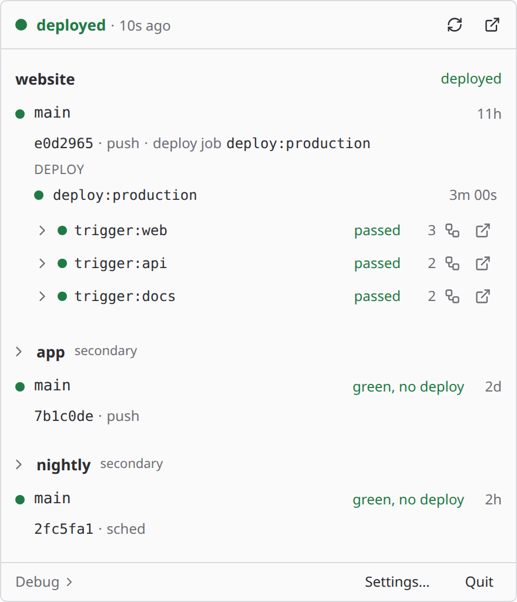

<picture>
  <source media="(prefers-color-scheme: dark)" srcset=".github/assets/distronode-logo-dark.png">
  <source media="(prefers-color-scheme: light)" srcset=".github/assets/distronode-logo-light.png">
  
</picture>

# bridgewatch

[](https://scorecard.dev/viewer/?uri=github.com/distronode-corporation/bridgewatch)
[](https://www.bestpractices.dev/projects/15887)
[](https://github.com/distronode-corporation/bridgewatch/releases/latest)

GitHub and GitLab pipelines in one tray app.

bridgewatch is a tray monitor for GitLab CI and GitHub Actions. It shows one row per push
with every downstream pipeline as a bridge, tells a scheduled pipeline apart from a push,
and reports whether the thing you care about actually deployed, instead of the raw
pipeline status.

A Rust core crate, a `bridgewatch` CLI and a Tauri 2 GUI (Svelte 5). macOS and Linux.
Apache-2.0.



*The 2.0 popover in the light theme, rendered from the app's frontend with sample data.*

**Status:** 2.1.0, released 2026-11-09. Download it from the
[Releases page](https://github.com/distronode-corporation/bridgewatch/releases/latest): a
signed and notarised universal `.dmg` for macOS, a `.deb`, an `.rpm` and an
`.AppImage` for Linux on x86_64 and arm64, and the CLI as tarballs, also on npm as
`bridgewatch`. See [Install](#install).

**Links:** [project page](https://www.distronode.com/open-source/bridgewatch) ·
[GitLab mirror](https://gitlab.com/distronode-corporation/bridgewatch) (read-only mirror;
issues and pull requests live on GitHub) · [CHANGELOG](CHANGELOG.md)

## What's new in 2.0

- **Sign in, no token to create**: on github.com and gitlab.com, approve a short code in
  your browser; the sign-in is kept in the system keychain and renews itself
  ([setup](docs/setup.md)).
- **Tokens stay with their server**: a pasted token is sent only to the server it was
  saved for, even after `base_url` changes
  ([tokens](docs/tokens.md#tokens-stay-with-their-server)).
- **One-click setup**: the wizard ticks your three most recently active projects, and
  **Watch N projects** sets them up at once
  ([wizard](docs/setup.md#first-run-the-setup-wizard)).
- **My builds and token health**: `mine = true` shows only your pipelines, and expiring
  tokens and sign-ins warn at 72 and 24 hours ([my builds](docs/app.md#my-builds),
  [token health](docs/tokens.md#token-health)).
- **`bridgewatch wait`**: blocks until a commit's pipeline has a verdict and exits with
  its code, for scripts and coding agents ([CLI](docs/cli.md)).
- **Clickable failure alerts**: the notification names the first failing line and opens
  the failed job ([failure alerts](docs/notifications.md#failure-alerts)).
- **Fixed again, and less noise**: a failure is announced once, a burst arrives as one,
  notifications can be paused, and a fix says "fixed again"
  ([notifications](docs/notifications.md)).
- **A new popover and Settings**: a footer for Debug, Settings and Quit, and five
  Settings panes instead of seven tabs.

Coming from 1.x? Read [Upgrading from 1.x](docs/tokens.md#upgrading-from-1x) and the
Breaking section of the [CHANGELOG](CHANGELOG.md) first.

## Install

**macOS, with Homebrew** (the signed and notarised universal `.dmg`, Apple Silicon and
Intel, macOS 10.15 or newer):

```
brew install --cask distronode-corporation/tap/bridgewatch
```

Or download `bridgewatch_<version>_universal.dmg` from the
[Releases page](https://github.com/distronode-corporation/bridgewatch/releases/latest).

**Linux** (x86_64 and arm64, glibc 2.35 or newer), from the same Releases page:

```
sudo apt install ./bridgewatch_2.1.0_amd64.deb          # Debian, Ubuntu
sudo dnf install ./bridgewatch-2.1.0-1.x86_64.rpm       # Fedora (zypper on openSUSE)
chmod +x bridgewatch_2.1.0_amd64.AppImage && ./bridgewatch_2.1.0_amd64.AppImage
```

On GNOME the tray icon needs the AppIndicator/KStatusNotifierItem extension.

**The CLI, with npm** (macOS, and Linux with glibc 2.35 or newer; Node.js 18 or newer):

```
npm install -g bridgewatch
npx bridgewatch check        # or run it once without installing
```

Every release asset carries a GitHub build provenance attestation:

```
gh attestation verify bridgewatch_2.1.0_amd64.deb --repo distronode-corporation/bridgewatch
```

The arm64 file names, the CLI tarballs, the signature checks, the licence files and what
each package depends on are in [Installing bridgewatch](docs/install.md).

## Quick start

**The app.** Install it (see [Install](#install)) and start it. With no config file it
opens the [setup wizard](docs/setup.md#first-run-the-setup-wizard):

1. Pick GitLab or GitHub Actions, and gitlab.com or github.com.
2. **Sign in with GitLab** (or GitHub) is already chosen. Approve bridgewatch in your
   browser with the short code it shows. There is no token to create or paste, and the
   sign-in is kept in the system keychain and renews itself.
3. The wizard lists your ten most recently active projects (or repositories), with the
   top three ticked. Untick any, press **Watch N projects**, then **Finish**.

The icon now follows those projects. On a self-managed GitLab or GitHub Enterprise
Server, sign-in needs an OAuth application of your own, so the wizard offers glab's or
gh's login, a pasted token or the others instead (see [Tokens](docs/tokens.md)).

**The CLI.** `init` prints a config without touching the network, and `auth login`
signs in:

```
npx bridgewatch init --project group/project > new-config.toml
# check new-config.toml, then move it to the path `npx bridgewatch config path` prints
npx bridgewatch auth login --account gitlab
npx bridgewatch check
```

For a GitHub repository, add `--provider github` to `init` and sign in with
`--account github`. `init`'s last line on stderr is the exact `auth login` command for
the account it wrote. Then `bridgewatch wait` after a push answers "did it ship" with an
exit code, see [CLI](docs/cli.md).

## Why bridgewatch

Most CI tray monitors define "project status" as the status of the newest pipeline on a
branch. On a real project three things go wrong with that.

**Scheduled pipelines dominate the branch.** A project with an hourly schedule on `main`
has far more scheduled pipelines than pushes, and a schedule can be red by design (a
reconciler that fails on purpose so drift is visible, for example). A monitor that reads
the newest pipeline then shows red most of the day and is soon ignored. It is not wrong
about any single pipeline; it is answering a different question.

**Fan-out hides the real result.** On GitLab a parent pipeline fans out to child
pipelines through trigger jobs (GitLab calls them bridges), and the parent's status is an
aggregate. On GitHub a push fans out into several independent workflow runs, and nothing
above them has a status at all. Either way nothing says *which* component broke, or "the
website deployed while a sibling failed", which is the most common shape of a partly-bad
push, and nothing notices a workflow that should have run and never started.

**"Pipeline succeeded" is not "it shipped".** A pipeline can be green because the deploy
job was skipped, is manual, or never ran. The question worth putting in a tray icon is
whether a named job ran and succeeded.

So bridgewatch is:

- **bridge-aware.** One row is one push, and each downstream is a bridge on it. On
  GitLab that is the parent pipeline, whose trigger jobs bridgewatch walks into their
  child pipelines (`dive.depth` levels deep, default 1). On GitHub it is a commit group
  (`group = "commit"`): every workflow run one push started, folded into one row with
  each run as a bridge. A bridge that never produced its downstream (a trigger job that
  settled without creating a child, or a workflow listed in `expect` that never started)
  reads dead; one still on its way to creating it reads running.
- **source-aware.** A watch filters by pipeline source or workflow event (`push`,
  `schedule`, ...) and by ref, so pushes, schedules and preflight branches are separate
  watches on the same project. Only `primary` watches drive the tray icon and
  notifications; `secondary` watches are rows in the popover and nothing else.
- **verdict-driven.** The icon state comes from marker jobs you name (for example
  `deploy:origins`), found anywhere in the parent or a child, not from the parent's
  status field.

What that adds up to:

- **"Did it ship", not "did it pass".** `deploy_markers` name the job that deploys, so a
  green pipeline whose deploy was skipped or manual does not read as deployed, and a
  deploy that went out while a sibling failed reads `deployed_with_failure`.
- **Alerts for runs that never happened.** `expect` turns a GitHub workflow that should
  have started and did not into a dead bridge and a failure notification.
- **Polling that leaves GitHub's limit alone.** Requests to GitHub are conditional, and a
  `304 Not Modified` does not count against the limit, so a settled watch costs nothing,
  see [Rate limits](docs/github-actions.md#rate-limits).
- **One core, with exit codes.** The tray app and the CLI share one Rust core, so
  `bridgewatch check` and `bridgewatch wait` give a script the icon's verdict as an
  [exit code](docs/cli.md#exit-codes).
- **The login you already have.** gh's and glab's keyring items are read in place, never
  copied, and sign-in is built in for github.com and gitlab.com.
- **Your own servers.** Self-managed GitLab and GitHub Enterprise Server work alongside
  the hosted ones, in one file.
- **Builds you can check.** The macOS app and CLI are signed and notarised, and every
  release asset carries a build provenance attestation, see [Install](#install).

## Documentation

- [Installing bridgewatch](docs/install.md): platform support, every release asset,
  signing and notarisation, attestations, and what guards the release path.
- [Setup and sign-in](docs/setup.md): the setup wizard and signing in with GitHub or
  GitLab.
- [GitHub Actions](docs/github-actions.md): commit groups, `expect`, tokens for GitHub,
  GitHub Enterprise Server and rate limits.
- [Tokens](docs/tokens.md): token sources, token health, tokens bound to their server,
  upgrading from 1.x, and reusing glab's login.
- [Configuration](docs/configuration.md): where the file lives, the full key reference
  and a walk-through of the examples.
- [Icon states and verdict rules](docs/verdicts.md): what each icon means and the rules
  that pick it.
- [Using the app](docs/app.md): the tray menu, logging, the job view and polling, my
  builds, deploy ETA, opening links and crash reports.
- [Notifications and noise](docs/notifications.md): what notifies, once, and failure
  alerts.
- [Retry and play](docs/retry-and-play.md): the opt-in writes and the token scopes they
  need.
- [CLI](docs/cli.md): every command and the exit codes.
- [Build from source](docs/building.md).
- [Limitations](docs/limitations.md).

Sections that used to live on this page keep their links:

### Upgrading from 1.x

Moved to [Tokens: Upgrading from 1.x](docs/tokens.md#upgrading-from-1x).

### Retry and play (opt in)

Moved to [Retry and play](docs/retry-and-play.md).

## Contributing, security and conduct

- [CONTRIBUTING.md](CONTRIBUTING.md): the layout, the inner loop and the whole local
  gate. The inner loop is `cargo test -p bridgewatch-core`, which runs against recorded
  fixtures and scripted responses with no network and no token.
- [SECURITY.md](SECURITY.md): the security model, and how to report a vulnerability
  privately through
  [GitHub's private vulnerability reporting](https://github.com/distronode-corporation/bridgewatch/security/advisories/new),
  not in a public issue.
- [CODE_OF_CONDUCT.md](CODE_OF_CONDUCT.md).
- [SUPPORT](.github/SUPPORT.md): questions and ideas go to
  [Discussions](https://github.com/distronode-corporation/bridgewatch/discussions), bugs
  to [Issues](https://github.com/distronode-corporation/bridgewatch/issues).
- [CHANGELOG.md](CHANGELOG.md).

## License and trademarks

Apache License 2.0. See [LICENSE](LICENSE) and [NOTICE](NOTICE).

The bridgewatch name and icon are trademarks of Distronode Corporation. They are not
licensed under the Apache License 2.0: a build you distribute must use its own name and
icon. bridgewatch is not affiliated with or endorsed by GitLab Inc. or GitHub, Inc.
